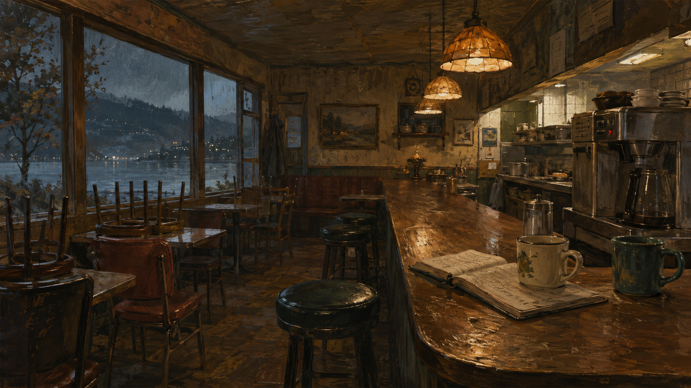

# NOT HERE

*A town has kept a place for someone. You arrive before she does.*

An intimate illustrated mystery about being loved as someone you are not. Lorn Bay, Okanagan Lake, November 6–28. A deterministic TypeScript story shared by browser and terminal.



## The revised edition

The revised story is playable from the beach through all seven endings. It includes an earlier letter discovery, a present-day exchange with Wren through Sam, a chosen name, optional preparations for arrival, and explicit ending decisions. An honest route can reach hope without any confession. Memory theft retains its cost.

All nine locations have painted compositions. The quilt loss, potluck, letters and bus arrival receive distinct staging. Seven painted character portraits open for a closer look; Wren’s portrait is withheld until arrival. A changed Kettle reflects work arranged under your own name. The reader includes inspectable evidence, a notebook, recent pages and separate sound controls. The illustrated town map includes roads, terrain, numbered landmarks, zoom controls, and an Okanagan Lake inset based on real geographic data. Prose appears immediately by default. Acoustic arrangements now span the later story and endings, with exact confession identities and designed environmental sounds. Silent play includes every clue.

**Production status:** the creator approved the new main theme, *A Place Kept*, on October 27. The revised soundtrack now uses sampled grand piano, fingerpicked guitar, and recorded wooden percussion across 26 cues and 13 character stems. The opening menu appears on the theme's first held melody note. Open `/art-review.html` for the paintings and listening room; major scenes and endings sit behind spoiler disclosures. Environmental Foley remains synthesized, and no voice performance is included. See [soundtrack and intro](design/soundtrack-a-place-kept.md) and [delivery and review](design/immersion-delivery.md).

## Play

```sh
pnpm install
pnpm render:audio
pnpm --filter @not-here/app-web dev
# Open http://localhost:5173

node apps/cli/src/main.ts
# Number chooses; o# observes; n notebook; h recent pages;
# m opportunities; l Barb's book; q quits. NH_SILENT=1 disables audio.
```

The opening review route follows the beach, the Kettle, Barb’s questions and the General’s upstairs room on Day 3. Try both sides of the quilt decision. Inspecting a cup or a timetable does not consume a visit. Choosing an activity does.

## Preserved original edition and saves

Open `?edition=original` in the browser, or run `NH_EDITION=original node apps/cli/src/main.ts`. The original story and UI are preserved.

The original browser key `not-here:slot1` and original CLI `.saves/slot1.json` are untouched by revised runs. The revised browser uses `not-here:story2:*`; the CLI uses `.saves/story2/`. The revised title offers export of an existing original browser save. Original paths cannot be migrated into the revised story; begin a clearly separate run. Reading and volume preferences persist independently.

## Develop and verify

```sh
pnpm typecheck
pnpm exec vitest run
pnpm story:metrics
pnpm build                 # reproduces audio, then builds the browser
```

The revised soundtrack ships as committed recordings; normal builds need no sample libraries or API key. `pnpm render:audio` reproduces the preserved original edition. `pnpm render:sampled` is an explicit local production command requiring the installed instrument libraries and Python dependencies documented in the [soundtrack notes](design/soundtrack-a-place-kept.md). `pnpm verify:soundtrack` checks the packaged assets, exact stem alignment, and mix headroom. Captions remain available for missing audio, and the browser does not preload the entire soundtrack.

| Package | Responsibility |
| --- | --- |
| packages/engine | Pure scene interpreter, facts, observations, names and presentation types |
| packages/story | Original content plus explicit edition-2 revisions and ending routes |
| packages/memory | Witness, salience, gossip and relationships |
| packages/music | Score data, synthesis, captions and reproducible WAV rendering |
| apps/web | Illustrated reader, documents, independent sound buses, original UI compatibility |
| apps/cli | Shared story, prose artifacts and terminal save/rewind |

## Publish on Vercel

Play the published game at [not-here-omega.vercel.app](https://not-here-omega.vercel.app).

The `not-here` Vercel project builds from the repository root. `vercel.json` runs `pnpm build` and publishes `apps/web/dist`, including the artwork, review room and generated soundtrack. No application environment variables or backend services are required.

For a production deployment, run these commands from the repository root:

```sh
vercel pull --yes --environment=production
vercel build --prod
vercel deploy --prebuilt --prod
```

GitHub builds copy the committed sampled soundtrack and regenerate only the original-edition audio. The revised score needs neither `ffmpeg` nor instrument libraries during deployment.

Design spoilers: [canon](design/game-bible.md), [clue table](design/twist-recontext-table.md), [asset provenance and final prompts](design/asset-provenance.md), [painted portraits](design/painted-portraits.json), [map geography and sources](design/map-geography.md). Earlier design decisions are retained as original-edition history.

Content: grief, memory loss, family estrangement and voluntary self-dissolution.
