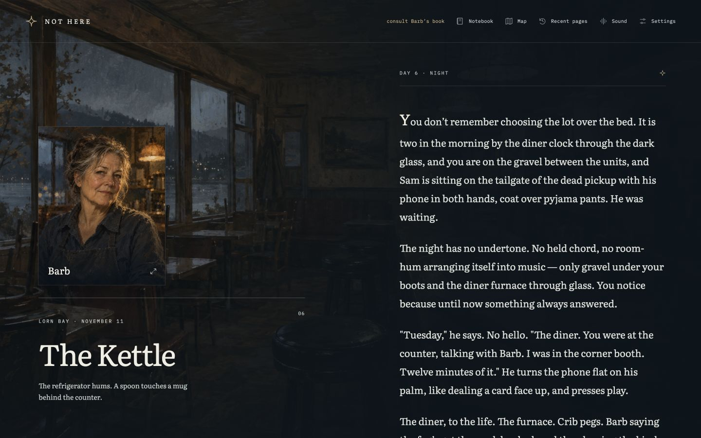

# Desktop AI playtest — October 20, 2026

Reached **Two Wrens** on Day 23, using the name **Codex**. The complete route was playable without a navigation, save, or reading-control failure. The strongest problems were presentation assignments: the wrong character during Sam’s confrontation, an inconsistent date during a transition, and an unexplained change of location at the ending.

## Scope and evidence

- Build supplied by parent: commit `96de769cc8fd2f06cf5b2946ff4bf71c462fd6e5`, served at `http://127.0.0.1:5210/`.
- Fresh, hidden IAB tab; desktop viewport **1440 × 900**. Existing tabs and saves on other ports were untouched.
- UI-only playthrough through `mcp__cua_repl`; no story source, tests, design spoilers, state injection, or alternate-route inspection.
- Reading session: **19:17:17–19:33:33 UTC**, **16 minutes 16 seconds**. This is AI interaction time, not a human reading-time estimate.
- **168 counted UI inputs**, including reading tools, settings, and one reload/resume; excludes browser setup, screenshots, read-only page snapshots, and cleanup.
- Configured text size to 20 and enabled Reduce motion through Settings. Audio was not audibly assessed.
- Reset the viewport and closed this run’s tab after the ending. Mobile tester received browser ownership.

## Route taken

| Days | Scenes and consequential choices |
| --- | --- |
| 1 | Inspected wet coat and shore stones; looked at the water; entered the Kettle; read the mugs; ate the full meal; reached toward Moose; chose Codex; chose window seat, no sugar, truthful register, light sleep, and no memory of leaving; helped with the sheet; inspected the winter schedule; waited at the window and listened. |
| 2–4 | Visited Dianne, took her hands, stayed for the mail; told Priya the wrist did not ache; visited Wade and asked about the light; studied the two conflicting phone photographs. |
| 5–7 | Rode with Tam, held his gaze, admitted uncertainty about staying; brought Wade bread and asked about the green door; told Sam “I don’t know” after his recordings; stayed with Barb on the quiet morning; entered the horn room because of Sam’s question; asked about the sixth bar, then stopped the horn. |
| 8–11 | Read Sam’s evidence and asked about the three canoe locations; gave Priya the actual memory of the first clinic visit; asked about the unclaimed casserole, left its name line blank; read Dianne’s albums and asked who sorted them; accepted supper and asked Barb about Frank. |
| 12–14 | Carried tables and ate at hall preparation; attended the potluck and defended Sam’s right to speak; examined the envelope and read both letters; repeated the truthful wrist answer to Priya; helped Dianne wrap dishes and asked what Sam meant at the hall. |
| 15–19 | Let Dianne retain her tune; gave Sam the chosen name; left Priya’s memory with her; asked Wren, through Sam, what she wanted on arrival; walked the town with the new knowledge; considered destroying the register but left it intact; heard Barb read back the month. |
| 20–23 | Accepted food and agreed to stay in contact; prepared a life of my own; arranged work and a room; stayed for the morning bus; introduced myself as Codex; told Wren what I knew and promised to stop taking memories and speak for myself. Reached **Two Wrens**, with Codex entered in Barb’s book and the hinge work waiting. |

## Observed issues

### 1. Sam’s confrontation displays Barb and the diner interior

**Impact: medium.** This is a major emotional scene, and its portrait labels the wrong person.

Reproduction on this route:

1. Reach Day 6 evening after bringing Wade the loaf.
2. Choose “Cross the lot to your unit.”
3. Read the scene beginning “You don’t remember choosing the lot over the bed.” Sam is on the pickup tailgate, plays the recordings, and asks what the protagonist is.
4. The presentation shows **Barb**, the **The Kettle** heading, and its interior image. Choosing “I don’t know” retains the same presentation on Sam’s response page.

Expected: Sam should be the identified character; the setting should support the exterior lot described in the passage. The parent independently confirmed the presentation assignment after receiving this observation.

### 2. November 23 transition retains November 22 / Day 17 night

**Impact: low.** The short transition contradicts its own date and time labels.

Reproduction: after the Day 17 night passage beginning “No horn,” choose “Let the morning come.” The next passage says **“November 23. The depot has put up the winter timetable.”** The stage still says **LORN BAY · NOVEMBER 22**, and the reading column says **DAY 17 · NIGHT**. Choosing “See Sam before the morning gets away” updates them to November 23 / Day 18 morning.

Screenshot: [incorrect date header](2026-10-20-evidence/desktop-date-header.jpg).

Coordinator follow-up: fixed in commit `685dd38`. The new regression failed before the fix; the corrected build passed 1,153 tests, type checking, the web build, and two code reviews. This original desktop run observed the defect, not the corrected build.

### 3. The ending relocates the meeting to the old wharf without a transition

**Impact: low to medium.** Wren arrives at the highway pull-in. The next conversation stays there, explicitly saying the bus is still idling behind her. After the promise to tell the truth, the ending immediately shows **The Old Wharf**, its compressor image and ambience text. The conversation and hand contact continue without a narrated walk or other location change.

Reproduction: prepare work and a room under the chosen name → stay for the morning bus → introduce that name → “Tell her what you know. Promise to stop taking and speak only for yourself.”

Screenshots: [arrival](2026-10-20-evidence/desktop-wren-arrival.jpg) and [ending](2026-10-20-evidence/desktop-two-wrens-ending.jpg).

### Smaller reader friction

- **Recent pages:** many rows have identical labels, such as “Day 1 · The Kettle.” Expanding works, but finding a particular conversation requires opening indistinguishable rows. A short passage cue would help.
- **Own-life route transition:** “Sit down with Barb.” appears on two consecutive screens on Day 22 evening. The first advances to a one-sentence transition that asks the same thing again; it briefly feels like the click did not finish its job.
- **Hinge continuity:** “Finish the hinge before the last evening” sounds like an action completed by choosing it. The resulting stage still calls it a loose hinge, and the ending says it will be finished tomorrow. This made the choice’s meaning uncertain.
- **After the letters:** knowing Wren was alive, I wanted to confront Dianne about the actual letters or tell Sam immediately. The available question that afternoon was “What did Sam mean? At the hall.” The later correspondence with Wren resolves the information gap, but that intervening conversation made the protagonist feel less direct than my chosen approach.
- **Day 17 sleep presentation:** after “Turn in” at the Kettle, the short 3:12 passage unexpectedly uses the General and Dianne. Unlike the Sam scene, the passage does not explicitly name a room, so this is an unexplained setting choice rather than a confirmed contradiction. Screenshot: [sleep location](2026-10-20-evidence/desktop-sleep-location.jpg).

## What worked

- The painted landscape, restrained color, large serif text, and portrait treatment make the opening feel like a place. At this viewport and text size, the tested reading screens and dialogs were legible, and I encountered no overlap or unusable control.
- Barb’s expanded portrait fits the dialog cleanly; Escape closes it and returns to the story.
- Map zoom changed from 100% to 150%; selecting the old wharf from the key zoomed to 200% and visibly centered/highlighted it. The map communicates local geography and the Okanagan setting clearly. Fit-map and closing returned to the same passage.
- “Take a closer look · No time passes” is useful reassurance. Observations appeared in the notebook, with evidence separated from incidental details. The document plain-text alternative and recent-page reread both worked.
- A reload on Day 2 evening returned to the title with “Return to your November.” Resuming restored the same scene and continuation choice. No progress was lost.
- Barb’s ledger gave a useful account of behavior without turning the story into a visible score sheet. The late readback accurately reflected my route: honest answers, stopping the horn, defending Sam, and leaving other people’s memories alone.
- The conflicting photographs, Sam’s recordings, the potluck’s physical response, and the two letters form a strong progression from unease to understanding. Food and practical work offer a readable way to sustain a self without taking someone else’s memories.
- Wren’s arrival pays off Moose’s earlier behavior. Her permission before touching the protagonist and her refusal to share her name make the ending’s acceptance feel specific. The chosen name and work arrangement both appeared in the outcome.

## Limits

This was one AI playthrough, not human playtesting, a full accessibility audit, or a survey of all endings. I did not test audio quality, audible timing, mobile layout, browser variants, every portrait expansion, or all possible map visits. The complete route and controls above were observed through the actual UI; alternate branches remain untested. No implementation files were changed.
